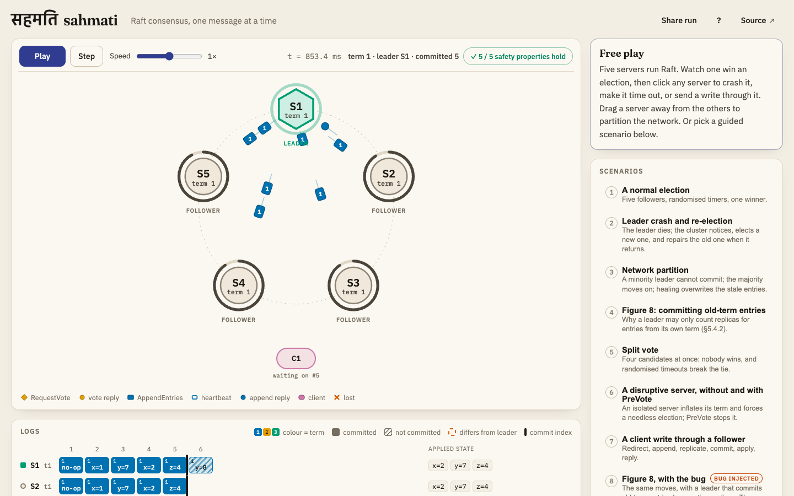
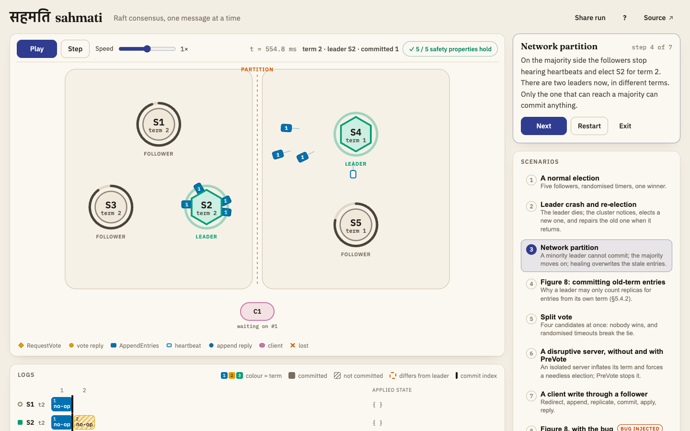
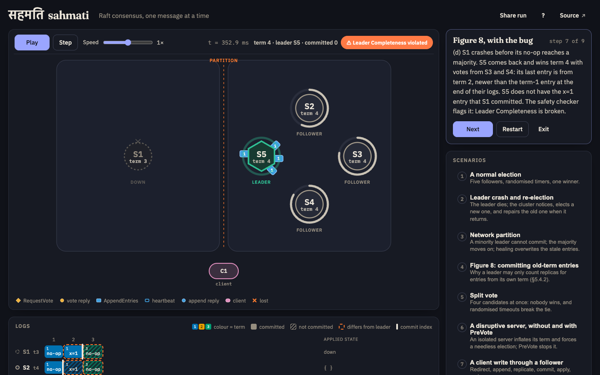
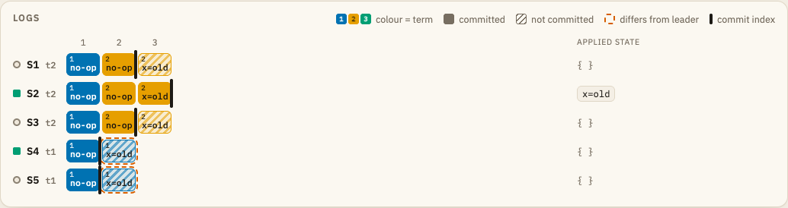
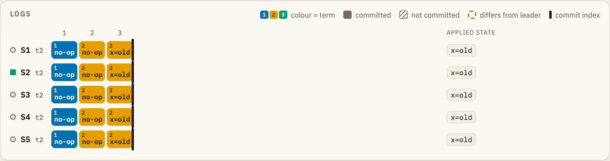
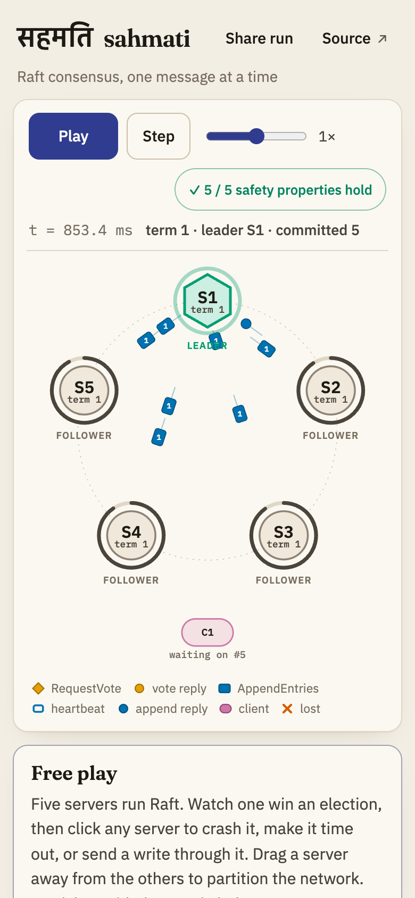

# sahmati · सहमति

*सहमति* (sahmati) is Hindi for "consensus" or "agreement".

[](https://samarthjaiswal.github.io/sahmati/)
[](https://github.com/SAMARTHJAISWAL/sahmati/actions/workflows/ci.yml)

An interactive simulator of the [Raft consensus algorithm](https://raft.github.io/raft.pdf) that runs in the browser. A cluster of three, five or seven servers runs a full Raft implementation inside a deterministic discrete-event simulation, with a replicated key-value store on top. You can crash and restart servers, split the network by dragging servers apart, drop or delay messages and send client writes, and watch leader election, log replication and commitment happen one message at a time.

**[Open the simulator →](https://samarthjaiswal.github.io/sahmati/)**


The same run, frozen mid-replication:



The Raft core is about 600 lines of TypeScript with no DOM code in it. It is checked by unit tests for each rule in the paper's Figure 2, by a fuzzer that checks all five of Raft's safety properties after every event, by a liveness check and a linearizability checker, and by mutation tests that inject known bugs into the implementation to show that the fuzzer catches them.

## Raft in a few paragraphs

A replicated state machine keeps several servers in agreement on a sequence of commands, so that the system keeps working when some of them fail. Raft (Ongaro and Ousterhout, 2014) does this with a strong leader. At any time each server is a **follower**, a **candidate** or the **leader**. Time is divided into numbered **terms**, and each term has at most one leader.

Followers expect regular heartbeats from the leader. If a follower's randomised **election timeout** runs out, it becomes a candidate, moves to the next term, votes for itself and asks the others for their votes with RequestVote. A server grants at most one vote per term, and only to a candidate whose log is at least as up to date as its own. A candidate that collects votes from a majority becomes leader.

The leader accepts client commands, appends them to its **log** and replicates them with AppendEntries. Each AppendEntries carries the index and term of the entry just before the new ones, and a follower refuses it unless its own log matches there. That check, plus deleting entries that conflict with the leader's, keeps every log a prefix-consistent copy of the leader's. Once an entry from the leader's current term is stored on a majority, it is **committed**, and every server applies committed entries to its state machine in log order.

## What you can do in the simulator

- **Watch** elections and replication: servers sit on a ring, with their role shown by colour and shape (follower circle, candidate diamond, leader hexagon), their term, and a ring that drains as their election timer runs down. Messages travel along the edges: amber diamonds are RequestVote, amber dots their replies, blue squares AppendEntries (hollow for a heartbeat, numbered with the entry count otherwise), blue dots their replies, pink for client traffic. Lost messages fade out with an ×.
- **Click a server** (or select it with <kbd>1</kbd>–<kbd>7</kbd>) to crash or restart it, make it time out now, send a write through it, or isolate it.
- **Split the network** by dragging a server away from the others, or onto another server's side. Presets: isolate the leader, put the leader in a minority, or leave no majority anywhere.
- **Change the network**: message loss from 0 to 50%, latency from 5 to 80 ms, and the PreVote and fast-backtracking options.
- **Send client commands** (`x=5`, `del x`, `get x`) to any server or to whichever one the client believes is the leader.
- **Read the logs**: each server's log as cells coloured and numbered by term (the key shows which colour is which), solid once committed and hatched until then, with the commit index drawn as a bar, entries that differ from the leader's outlined, and each server's applied key-value state.
- **Follow the event log**, filtered by elections, replication, client, faults or individual messages.
- **Control time**: play, pause, step one event at a time, and run from 0.1× to 10× speed. At 1×, a 20 ms message takes 0.2 s to cross the screen.
- **Share a run**: the link encodes the seed, the configuration and every action you took, so opening it replays the run to the identical state.
- A **safety badge** runs the same checker as the test suite on every event, and turns red if a property is ever violated (see the last scenario).

Keyboard: <kbd>Space</kbd> play/pause, <kbd>.</kbd> step, <kbd>c</kbd> crash/restart the selected server, <kbd>t</kbd> time out, <kbd>w</kbd> write via it, <kbd>i</kbd> isolate, <kbd>h</kbd> heal, <kbd>n</kbd> next scenario step, <kbd>r</kbd> reset, <kbd>?</kbd> help. The page follows the system's light or dark theme, respects `prefers-reduced-motion` (messages are drawn standing still at the middle of their edge instead of travelling), stops the simulation while the tab is hidden, and works on a phone.

## Scenarios

Each scenario loads a fixed seed and set-up, runs until something worth seeing happens, and pauses with a caption. The captions name the actual servers and terms, because every run of a scenario is the same.

1. **A normal election**: five followers, randomised timers, one winner, the no-op entry, heartbeats.
2. **Leader crash and re-election**: the cluster notices the silence, elects a new leader, keeps committing with four servers, and repairs the old leader's log when it returns.
3. **Network partition**: the leader is cut off with one follower. It accepts a write but cannot commit it; the majority side elects a new leader; the client retries there; on healing, the old leader steps down and its uncommitted entries are overwritten.
4. **Figure 8**: the paper's crash sequence in which an entry stored on a majority is still overwritten, and why a leader only counts replicas for entries from its own term.
5. **Split vote**: four servers time out at the same instant, nobody can win, and randomised timeouts break the tie.
6. **A disruptive server, without and with PreVote**: an isolated server inflates its term and forces a needless election when it returns; with PreVote it does not.
7. **A client write through a follower**: redirect, append, replicate, commit, apply, reply.
8. **Figure 8, with the bug**: the same moves on servers that commit old-term entries by counting replicas. The safety checker flags a Leader Completeness violation, and a write the client was told had succeeded disappears.

| Partition (scenario 3): two leaders in different terms | Figure 8 with the bug injected (scenario 8, dark theme) |
| --- | --- |
|  |  |

The log table before and after the partition heals. S4 and S5 hold `x=old` at index 2 from term 1, outlined because it differs from the new leader's log; after the heal, the consistency check finds the conflict and they take the leader's entries:






## How it works

### A deterministic simulation

Nothing in the simulation reads a real clock or `Math.random`. Time is a number of simulated milliseconds that only moves when the next event is processed. Pending events (message deliveries, election and heartbeat timers, client retries) wait in a binary heap keyed by *(time, sequence number)*, where the sequence number is a global insertion counter, so events at the same instant always fire in the order they were scheduled. Every random choice (election timeouts, latency jitter, message loss) comes from one seeded PRNG (sfc32, seeded through splitmix32).

A run is therefore a pure function of its seed, its configuration and the user's actions. Each action is recorded with the number of events processed before it and the simulated time, which is enough to replay it exactly. This is what makes three things possible:

- **share links**: the URL hash holds the configuration and the action list, and opening it replays to a state that is identical down to the election-timer deadlines (the tests compare a full fingerprint of every server, message and client);
- **reproducible failures**: a failing fuzz seed fails the same way every time, so it can be shrunk and debugged;
- **scripted scenarios** whose captions can say "S5 wins term 4".

The browser maps real time to simulated time (0.1 simulated ms per real ms at 1×). When a scenario is waiting for a condition, the UI processes events one at a time and stops on exactly the event that makes the condition true, so the headless tests and the animated page go through identical states.

### The Raft implementation, mapped to Figure 2

[`src/raft/node.ts`](src/raft/node.ts) follows Figure 2 of the paper closely; the comments quote the rules.

| Figure 2 | Where |
| --- | --- |
| Persistent state: `currentTerm`, `votedFor`, `log[]` | fields that survive `crash()` / `restart()` |
| Volatile state: `commitIndex`, `lastApplied`; leaders' `nextIndex[]`, `matchIndex[]` | reset on restart and on election |
| RequestVote receiver: reject older terms; grant if not voted (or voted for this candidate) and the candidate's log is at least as up to date (§5.4.1) | `onRequestVote`, `isUpToDate` |
| AppendEntries receiver rules 1–5: reject older terms; consistency check on `prevLogIndex`/`prevLogTerm`; delete conflicting entries and all that follow; append new ones; `commitIndex = min(leaderCommit, index of last new entry)` | `onAppendEntries` |
| All servers: step down on a higher term in any request or reply; apply committed entries in order | `stepDown`, `applyCommitted` |
| Followers and candidates: randomised election timeout (150–300 ms); start an election on timeout; candidates become leader on a majority and step down on an AppendEntries of their term | `onElectionTimeout`, `startElection`, `onRequestVoteReply` |
| Leaders: heartbeats (every 50 ms); append client commands; retry with a lower `nextIndex` on rejection; commit only entries from the current term once on a majority (§5.4.2) | `onTimer`, `onClientRequest`, `onAppendEntriesReply`, `advanceCommitIndex` |

A new leader appends a **no-op** entry (§8), which lets it commit entries left over from earlier terms straight away. Followers redirect clients to the leader they know. Two rejection details matter in practice: a leader ignores a rejection that does not answer its current probe (otherwise duplicate rejections would walk `nextIndex` back too far), and a follower never moves `commitIndex` backwards.

**Fast log backtracking** (optional): a rejecting follower reports the term of its conflicting entry and the first index it holds for that term (or its log length if it is too short). The leader jumps to just after its own last entry of that term, or to the follower's first index for it, skipping a whole term per round trip instead of one entry. This is the optimisation sketched at the end of §5.3; it changes performance, not safety, and the fuzzer runs with it on and off.

### The network model

Every message gets a latency of `latency ± jitter` ms (default 20 ± 8), so messages can overtake each other. Each message is independently lost with the configured probability. A partition is a set of groups; a message between servers in different groups is dropped, both when it is sent and if the partition appears while it is in flight. A crashed server drops whatever arrives. Clients sit outside the partitions and can reach every server; message loss applies to them too.

A crash keeps the persistent state (term, vote, log) and loses the rest: role, commit index, leader state and the key-value store, which is rebuilt by re-applying the log once the server learns the commit index again.

### PreVote

Without PreVote, a server cut off from the cluster keeps timing out and incrementing its term. When it reconnects, its higher term forces the healthy leader to step down, and the cluster holds an election it did not need. PreVote (Ongaro's thesis, §9.6) adds a trial round: on timeout, a server asks "would you vote for me in term *T*+1?" without changing its own term. Receivers answer without changing any state, and refuse if they have heard from a leader within the minimum election timeout or if the candidate's log is behind theirs. Only with a majority of pre-votes does the server start a real election. Scenario 6 shows both behaviours on the same cluster; the toggle is in the Network panel.

### The key-value state machine

Commands are `set k v`, `del k` and `get k`. All three go through the log, which makes reads linearizable at the cost of a round of replication (the paper's §8 also describes a cheaper read-index approach, not implemented here). Each command carries the client's id and a sequence number; the state machine remembers the last one applied per client and answers retries from that cache, so a write that a client retries, and that ends up in the log twice, takes effect once. Clients keep one operation outstanding, follow redirects, and try another server after 250 ms without a reply.

## Testing

`npm test` runs 86 tests in about 1.5 seconds: 43 unit tests of the Figure 2 rules, 13 scenario tests, 13 determinism and share-link tests, 8 tests of the linearizability checker, a 2,000-seed fuzz run and 8 mutation tests.

### The five safety properties

[`src/raft/invariants.ts`](src/raft/invariants.ts) checks the properties from Figure 3 of the paper after **every** event (every message delivery, timer and user action):

| Property | How it is checked |
| --- | --- |
| **Election Safety**: at most one leader per term | a map from term to the one server ever seen as leader in it |
| **Leader Append-Only**: a leader never overwrites or deletes its own entries | while a server stays leader in a term, each new log must extend the previous one |
| **Log Matching**: same index and term ⇒ identical logs up to that index | every entry has a unique id; each *(index, term)* pair ever observed, in any log, must always name the same entry *and* the same predecessor, which by induction gives identical prefixes |
| **Leader Completeness**: a committed entry is in the log of every later leader | committed entries are recorded with the term they were committed in; when a server becomes leader of term *T*, its log must hold every entry committed in an earlier term |
| **State Machine Safety**: no two servers apply different entries at one index | every applied (and every committed) index is recorded once and compared |

The checker is incremental (it only re-reads logs that changed), so it adds little to the run time. The same checker drives the safety badge in the browser.

### The fuzzer

[`src/raft/fuzz.ts`](src/raft/fuzz.ts) turns a seed into a random case: a cluster of 3, 5 or 7 servers, 1–3 clients, random latency, jitter and loss, PreVote and fast backtracking on or off, batch sizes from 1 to 64, and the election no-op on or off. Then 4–30 faults over 3 seconds of simulated time, plus 4–24 client operations. Faults are crashes, restarts, crash-then-quick-restart, crashing whoever is leader, random partitions, isolating the leader (alone or with one follower), heals, forced timeouts, changes in loss rate, latency spikes slower than an election timeout, and **leader churn** (crash, or cut off and then crash, each new leader shortly after it is elected, and bring it back later). Each case enables a random subset of fault kinds with random weights (*swarm testing*, Groce et al. 2012), so some cases are dominated by one kind of fault and reach deep states, such as long chains of leader changes, that an even mix rarely does.

After the faults, the network heals, loss and latency return to normal and every server restarts. Then:

- **liveness**: within 4 s of simulated time (plus 0.4 s for each client operation still queued) there must be a leader that every server follows, identical logs, everything committed and applied everywhere, and no client still waiting;
- **acknowledged writes are never lost**: every acknowledged operation must sit at the index it was acknowledged at, in the final log;
- **linearizability**: the whole client history, plus a final read of every key, must pass the checker below.

A failure prints the seed, the property, a command to rerun just that seed, and a shrunk reproduction: the case with every action removed that is not needed for the same failure (greedy one-at-a-time removal, which works because replay is deterministic).

Numbers, on an Apple-silicon laptop under Node 26:

| Seeds | Wall time | Events | Messages | Client ops | Failures |
| ---: | ---: | ---: | ---: | ---: | ---: |
| 2,000 (CI default) | 1.2 s | 2.8 M (1,415 per seed, max 11,114) | 2.0 M | 28,011 | 0 |
| 20,000 (`npm run fuzz`) | 11.0 s | 28.2 M (1,409 per seed, max 12,096) | 19.9 M | 280,371 | 0 |
| 100,000 more (seeds 20,001–120,000) | 55.9 s | 141 M (1,412 per seed, max 14,433) | 99.7 M | 1,404,380 | 0 |

Convergence after the heal takes a median of about 800 ms and a 99th percentile of about 3.7 s of simulated time; the slowest of the 120,000 runs took 5.6 s, with a long client backlog to drain.

Run more with `FUZZ_SEEDS=100000 npx vitest run tests/fuzz.test.ts`, a different range with `FUZZ_START`, or one seed with `FUZZ_SEED=1234`.

### Linearizability

[`src/raft/linearizability.ts`](src/raft/linearizability.ts) is a Wing & Gong style search with memoisation of *(set of linearized operations, register value)*, as in Lowe's refinement. Linearizability is a local property, so each key is checked as an independent register with `set`, `del` and `get`. Operations that never got a reply may have taken effect or not: a pending write can be placed anywhere after its invocation or left out, and a pending read constrains nothing. The search has a budget of 100,000 states per key; running out counts as a failure. In practice the fuzzer's histories are short (around 14 operations per seed over two keys), and on 120,000 correct fuzz runs the budget was never reached.

What this covers: every client operation in every fuzz run, including retried writes that end up in the log twice, reads served during partitions, and leader changes in the middle of an operation. What it does not cover: histories longer than a few dozen operations per key (the search is exponential in the worst case), and anything outside the simulator's own client model.

### Mutation tests: does the fuzzer have teeth?

Each mutation is a one-line, realistic bug behind a test-only flag (`mutations` in the config). [`tests/mutation.test.ts`](tests/mutation.test.ts) runs the same fuzzer with the bug switched on and asserts that some seed fails within 20,000 seeds; it stops at the first one. The catch rate is the share of the first 10,000 seeds that fail.

| Injected bug | Caught by | First failing seed | Catch rate |
| --- | --- | ---: | ---: |
| Leader commits old-term entries by counting replicas (the Figure 8 bug) | Leader Completeness | 330 | 0.05% |
| Votes granted without the up-to-date log check (§5.4.1) | Leader Completeness | 12 | 17% |
| More than one vote per term (`votedFor` ignored) | Election Safety | 3 | 61% |
| `votedFor` not persisted across a crash | Election Safety | 660 | 0.2% |
| Vote replies from an earlier term counted | Election Safety | 468 | 0.1% |
| AppendEntries skips the `prevLogIndex`/`prevLogTerm` check | Log Matching | 1 | 69% |
| A conflicting entry is overwritten without deleting the entries after it | Log Matching | 4 | 12% |

All seven are caught, each in under half a second. The Figure 8 bug is the hardest: it needs a leader whose entry stays on one server, a second leader elected without it, the first leader re-elected and replicating its old entry to a majority, and a crash in the one round trip before its own no-op lands. The leader-churn fault and swarm testing were added to the fuzzer for this bug; before them it survived 5,000 seeds.

One more mutation is in the code and not in the table, because no test of behaviour can catch it here: a follower that caps its new `commitIndex` at the end of its own log, `min(leaderCommit, last log index)`, instead of at the last entry the request carried, `min(leaderCommit, index of last new entry)`. The two differ only when the follower holds entries past the end of the request. That is harmful only if those entries differ from the leader's, and in this implementation that never happens. A leader's first successful AppendEntries to a follower whose log has diverged starts at the first conflicting index, so the stale suffix is deleted before the commit rule runs. The requests that do end early are late or reordered ones, and by the time they arrive the entries after them came from the same leader.

Measured rather than argued: with the commit rule instrumented over 60,000 fuzz seeds (19 million AppendEntries), the mutated rule would have produced a different `commitIndex` 265 times. In the 261 of those where the sender was still leader to compare against, every extra entry was identical to the leader's, so the mutation would have committed nothing wrong. In mutation-testing terms it is an *equivalent mutant* for this implementation. It would become a real bug in a design where a follower can keep a stale suffix past a request, for example one that pipelines requests from an optimistic `nextIndex`. A unit test (`raft-rules.test.ts`) pins the correct rule by building that state by hand.

### Determinism and share links

Tests run the same seed and actions twice and compare full traces; replay recorded actions and compare fingerprints of every server, message and client; round-trip a run through the URL hash encoder and replay it; and do the same for a link made halfway through every scenario.

### End to end

[`scripts/e2e.py`](scripts/e2e.py) drives a production build through the real UI with Playwright: 43 checks, covering a leader within a few seconds of load at 1× speed, crash and re-election by clicking, a minority partition that cannot commit and a heal that converges every log, a client write visible in every server's key-value state, keyboard shortcuts, the share-link round trip, every scenario stepped to the end (and the bug scenario turning the badge red), the title and Source links, a 390×844 phone viewport with no horizontal overflow and tappable controls, reduced motion, pausing in a hidden tab, and no console errors.

## Deliberate simplifications

- **No real network or disk.** Messages are objects in a queue and "persistent" state is the part of a server object that survives `crash()`. Partial writes and corrupted disks are not modelled.
- **No cluster membership changes** (joint consensus or single-server changes), and **no log compaction or snapshots**: logs grow for the whole run.
- **No leadership transfer**, and no leader lease or read-index reads: reads go through the log.
- **Clients are never partitioned** from servers, and the UI has one client (the fuzzer uses up to three).
- **Message loss is independent per message**; there is no duplication. Reordering comes only from latency jitter.
- **Timing is idealised**: servers do no work between events, and timers are exact.
- **Each server lives in one JavaScript heap.** The isolation between them is the simulator's message passing, not an operating-system boundary.

## Project structure

```
src/
  raft/           the Raft core: pure TypeScript, no DOM
    node.ts         one server: Figure 2 rules, PreVote, fast backtracking, injectable bugs
    sim.ts          discrete-event simulation: event queue, network, clients, actions, replay
    queue.ts        binary heap keyed by (time, sequence)
    rng.ts          seeded PRNG (sfc32 + splitmix32)
    kv.ts           the key-value state machine with per-client deduplication
    invariants.ts   the five safety properties, checked incrementally
    linearizability.ts  Wing & Gong checker for the client history
    fuzz.ts         case generation, nemesis, liveness check, shrinking
    types.ts
  scenarios.ts    the guided scenarios (shared by the UI and the tests)
  share.ts        encode / decode / replay share links
  ui/             the page: stage (SVG), log table, event timeline, controller
  main.ts, style.css
tests/            Vitest: rules, scenarios, determinism, linearizability, fuzz, mutations
scripts/          e2e.py, capture.py and record_gif.py (Python Playwright)
docs/             screenshots and the demo GIF
```

The front end is plain TypeScript and SVG with no framework: the page is one canvas-like view plus a few panels, and updating them directly each frame was simpler than introducing a rendering library. Fonts (IBM Plex Sans, Plex Mono, Plex Sans Devanagari and Fraunces) are bundled through Fontsource, so the site makes no third-party requests. The production bundle is 73 KB of JavaScript (24 KB gzipped) and 22 KB of CSS (6 KB gzipped), plus fonts.

## Running locally

Requires Node 22.12 or later.

```sh
npm ci
npm run dev          # http://localhost:5173
npm test             # unit, scenario, determinism, 2,000-seed fuzz, mutation tests
npm run fuzz         # 20,000 seeds
npm run typecheck
npm run build        # dist/, served from /
npm run build:pages  # dist/, served from /sahmati/ (what GitHub Pages gets)
```

End-to-end checks and screenshots use Python Playwright (`pip install playwright && playwright install chromium`):

```sh
npm run build:pages
mkdir -p /tmp/site && rm -rf /tmp/site/sahmati && cp -r dist /tmp/site/sahmati
(cd /tmp/site && python -m http.server 8765) &
python scripts/e2e.py http://localhost:8765/sahmati/

npm run build && npx vite preview --port 4173 &
python scripts/capture.py http://localhost:4173/
python scripts/record_gif.py http://localhost:4173/   # docs/demo.gif, also needs Pillow
```

Pushing to `main` runs CI (typecheck, tests, both builds) and deploys to GitHub Pages.

## References

- Diego Ongaro and John Ousterhout. [In Search of an Understandable Consensus Algorithm](https://raft.github.io/raft.pdf). USENIX ATC 2014. Figure 2 (the rules), Figure 3 (the safety properties), Figure 8, §5.4 (safety), §8 (client interaction).
- Diego Ongaro. [Consensus: Bridging Theory and Practice](https://github.com/ongardie/dissertation). PhD thesis, Stanford University, 2014. §9.6 (preventing disruptions with PreVote).
- Jeannette Wing and Chun Gong. Testing and Verifying Concurrent Objects. Journal of Parallel and Distributed Computing, 1993.
- Gavin Lowe. Testing for Linearizability. Concurrency and Computation: Practice and Experience, 2017.
- Maurice Herlihy and Jeannette Wing. Linearizability: A Correctness Condition for Concurrent Objects. ACM TOPLAS, 1990.
- Alex Groce, Chaoqiang Zhang, Eric Eide, Yang Chen and John Regehr. Swarm Testing. ISSTA 2012.
- Okabe and Ito, *Color Universal Design*: the colour palette for roles and terms.

## Licence

[MIT](LICENSE) © 2026 Samarth Jaiswal
